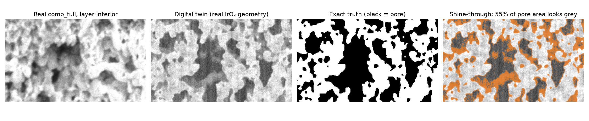

# Digital twin: measuring segmentation error under shine-through, with exact truth

Real pFIB-SEM stacks of porous electrodes have no ground truth. Through every pore opening the
microscope sees material *behind* the cut plane (shine-through), so a pixel's grey value does not
decide its phase, and any label made from the image inherits that ambiguity. Published methods
(Salzer, Prill, Ferner, Osenberg) are therefore compared on different samples and different label
definitions. This project builds a calibrated **digital twin** of the measurement so that every method
can be scored against the exact answer, on IrO₂ catalyst-layer morphology.



## How the twin works (`eponge/simulate.py`)

1. **Geometry.** 3D pore/solid blocks cut from the segmented comp_full catalyst layer (real IrO₂
   morphology; train slices 0–179, validation 180–249, test 250–353, so test structures are physically
   separate material), plus random-field structures for variety during training.
2. **Imaging.** For each cut plane z and pixel (y, x), the viewing ray reaches voxel
   (z + t, y + s·t, x) at depth t, with s = 1 px/slice, the streak rate measured on the real stack.
   Solid at the plane → cut face (bright, edge brightening, fine grain). Pore at the plane → first solid
   behind it at depth t\* seen with brightness floor + (back − floor)·exp(−(t\* − 1)/λ); nothing within
   reach → floor.
3. **Detector.** PSF blur, signal-dependent noise, curtaining and vertical streak texture, 8-bit
   saturation.
4. **Calibration.** cut, back, floor and λ are fitted so the twin's grey-level percentiles match the real
   catalyst layer: 1/5/25/50/75/95 % = 72/90/159/206/228/253 (twin) vs 62/98/159/197/231/255 (real),
   mean error 5.3 grey levels; best fit is interior to the search grid (λ = 18 slices, floor 90).
5. **Truth.** The phase of the cut plane itself. On the test geometry, 55 % of the true pore area appears
   grey rather than black.

## Results with exact truth

Held-out twin volumes with real IrO₂ geometry (4 volumes, 136 cut planes, ~5.3 M pixels):

| method | pore IoU | porosity (true 0.456) | bias | x–z anisotropy (true 0.197) |
|---|---:|---:|---:|---:|
| Otsu, denoised | 0.768 | 0.353 | −0.103 | 0.218 |
| Ferner-style z-gradient (`pore_pipeline`, after Ferner et al. 2024) | 0.854 | 0.449 | −0.007 | 0.237 |
| ResUNet 2D, trained on twin truth | **0.928** | 0.451 | −0.005 | **0.195** |
| MillNet 2D, trained on twin truth | 0.909 | 0.439 | −0.017 | 0.200 |
| MillNet 7-slice, trained on twin truth | **0.929** | 0.448 | −0.008 | **0.199** |
| MillNet 7-slice with streak bank, twin truth | 0.925 | 0.444 | −0.012 | 0.202 |

Same experiment on random-field geometry (robustness check; 4 volumes, true porosity 0.403):
Otsu 0.700 (bias −0.114), Ferner-style 0.792 (−0.022), ResUNet 2D 0.941, MillNet 2D 0.941,
MillNet 7-slice **0.965** (−0.003, anisotropy equal to truth).

Networks trained on the real comp_full labels are not meaningful on the twin (pore IoU 0.48–0.78):
their labels are a threshold rule and their input normalisation expects the Pt cap and membrane in
the frame, which twin frames do not contain.

## What the twin shows

1. **Shine-through biases thresholding by about −0.10 porosity** (−23 % relative), on both geometries.
   The original napari labels and every model trained on threshold-derived labels inherit this.
2. **Ferner's z-gradient idea removes the porosity bias** (−0.007 to −0.022) but places pores less
   accurately (IoU 0.85) and elongates them along z (anisotropy 0.237 vs 0.197).
3. **A network trained on the calibrated twin beats the Ferner-style method on every measure**:
   +0.07 to +0.17 pore IoU, equal or smaller porosity bias, and pore shapes as isotropic as the truth.
4. **Slice context helps when the labels are true.** MillNet 7-slice gains +0.02 IoU over MillNet 2D
   on both geometries. On real geometry a plain 2D ResUNet reaches the same IoU, so the architecture
   matters less than the training signal: the gain comes from learning the physics with exact truth.

## Back on the real stack

comp_full layer interior, frames 0–129 (the region every method covers):

| method | porosity | x–z anisotropy | porosity sd over z |
|---|---:|---:|---:|
| Otsu, denoised | 0.356 | 0.137 | 0.034 |
| models trained on real (threshold-derived) labels | 0.381–0.401 | 0.135–0.139 | 0.029–0.031 |
| Ferner-style z-gradient | 0.534 | 0.179 | 0.027 |
| MillNet 7-slice, trained on twin truth | 0.522–0.530 | 0.146–0.154 | 0.022–0.025 |
| MillNet 2D, trained on twin truth | 0.485 | 0.175 | **0.017** |
| *Ferner et al. 2024, published value for this region* | *0.417* | | |

Two independent shine-through-aware approaches (the twin-trained network and the z-gradient method)
agree on a porosity of about **0.52–0.53**, while threshold-based estimates give 0.36–0.40. On the
twin, thresholding under-reads porosity by ~0.10 with the same imaging statistics, which accounts for
most of that gap. The comp_full catalyst-layer porosity is therefore likely higher than both the
threshold estimates and the published 0.417. Ferner et al.'s exact pipeline (parameters, ROI) differs
from the reimplementation used here, so the published number is a reference, not a like-for-like
comparison.

The label-free isotropy check does not separate the methods on real data (0.135–0.179): the real
structure, the anisotropic z sampling and the imaging all contribute, so it cannot serve as an accuracy
measure on its own.

## Limits

* The twin's geometry comes from a segmentation of the same stack, made by a model trained on
  threshold-derived labels; its pore shapes may carry some of that bias (true anisotropy 0.197).
  SliceGAN-style generation from real slices is the next step.
* Real pore walls look softer than the twin's; sub-resolution roughness is not modelled.
* The Ferner-style method is D. Garodia's reimplementation; Ferner et al.'s code was not available.
* One training seed per twin model; the random- and real-geometry experiments agree, but seeds would
  tighten the error bars.
* The sim-to-real gap is not closed: twin-trained models give 0.49–0.53 on the real stack depending on
  the variant, which should be reported as a range.

## Reproduce

```bash
python eponge/scripts/segment_full_stack.py --device mps                 # real geometry source
python eponge/scripts/twin_experiment.py --geometry real --out runs/twin_real
python eponge/scripts/twin_experiment.py --geometry grf  --out runs/twin  # random-field robustness check
```
Results: `runs/twin_real/part_a_exact_truth.json`, `part_b_real_label_free.json`; example stack and
truth in `runs/twin_real/examples/`.
