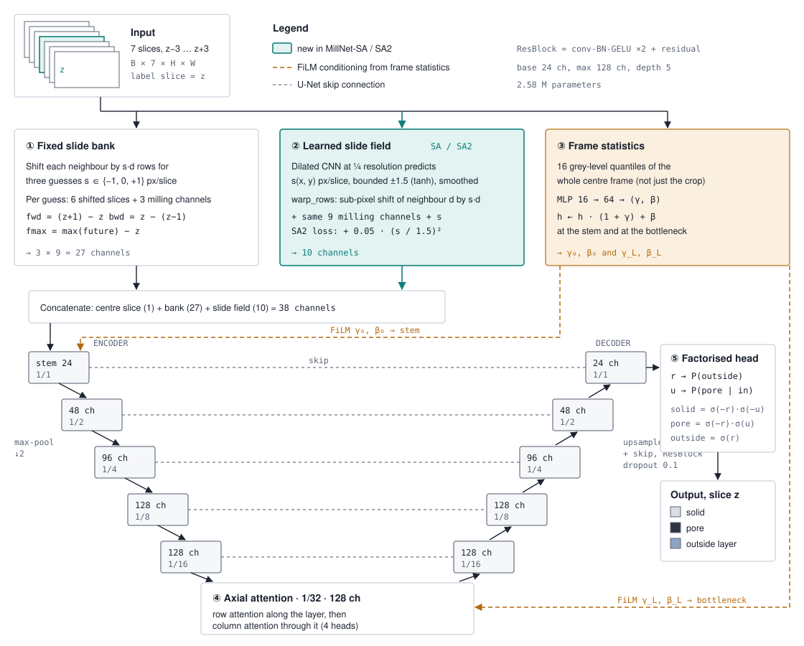
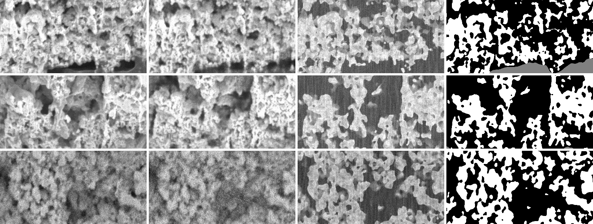

# Segmentation models and digital twin: final results

*Final as of Tuesday 27 October 2026. All runs are finished. Every number below comes from
`runs/final_models/report/results.json` or the run's `summary.json`.*

---

## 1. What we set out to show, and what holds

| # | Claim | Result |
|---|---|---|
| 1 | A new hand-annotated benchmark: three acquisitions (comp, uncomp, pristine), four annotators, two review rounds | **Holds.** Fleiss' kappa 0.969 / 0.987 / 0.995 (`final_dataset/*/stats.json`) |
| 2 | Our model beats the strongest standard baseline (nnU-Net) | **Holds** on the hand-annotated test set: +1.6 mIoU at equal training budget, 3 seeds. Significant on uncomp and pristine, tied on comp |
| 3 | Ablations show what makes it work | **Done.** Frame-level contrast conditioning is the part that matters. The shine-through-specific inputs do not help measurably |
| 4 | A digital twin gives images with exact masks | **Built and validated.** The GAN twin is far closer to real than the physics twin. On exact truth our model is **on par with**, not better than, a pretrained U-Net |
| 5 | Generalising to an unseen acquisition | **Weak without labels** (unseen pristine 0.656). **2 labelled slices** bring it to 0.913, and 5 to 0.937 |
| 6 | External validity | Public FIB-SEM benchmark: ties the published CNN, beats the published random forest |

---

## 2. Data and scoring

* **Data:** `final_dataset/`, three stacks, slices 0–117, 3 classes (solid, pore, outside the layer).
* **Split:** train 0–83, validation 87–97, test 101–117. The gaps stop ±3-slice context from crossing splits.
* **Metric:** mean IoU over the 3 classes on the test slices, with flip test-time augmentation.
* **Model selection:** all choices were made on validation only, including which model is "proposed".
* **Significance:** paired bootstrap over test slices against nnU-Net 2D (2,000 resamples, 95 % CI).
* **"Matched budget":** 7,500 steps, batch 6, 512 px crops, the same training budget as nnU-Net 2D.
  The "standard budget" (3,000 steps, batch 8, 256 px) sees about 7.5× less image area.

---

## 3. The proposed model: MillNet-SA2

The input is 7 consecutive slices; the output is solid / pore / outside for the centre slice. It has 2.6 M parameters,
about a tenth of the pretrained baselines. Section 5 shows which parts matter. In short, ③ frame statistics carries the
gain. ① ② and the multi-slice input are kept because they cost little, but they do not change accuracy measurably.

---

## 4. Main results (real test set, hand-annotated labels)

### 4.1 Comparison (test mIoU)

| Model | Seeds | comp | uncomp | pristine | **Mean** | Params |
|---|---|---|---|---|---|---|
| **MillNet-SA2, matched budget** | 3 | 0.913 ± 0.003 | **0.946 ± 0.002** | **0.948 ± 0.002** | **0.935 ± 0.001** | 2.6 M |
| MillNet (no learned slide), matched budget | 1 | 0.912 | 0.948 | 0.950 | 0.937 | 2.6 M |
| nnU-Net 2D (Isensee et al., Nature Methods 2021) | 1 | **0.915** | 0.922 | 0.921 | 0.919 | – |
| U-Net ResNet-34 (ImageNet), matched budget | 1 | 0.900 | 0.893 | 0.933 | 0.909 | 24 M |
| MillNet-SA2, standard budget | 3 | 0.898 ± 0.004 | 0.924 ± 0.004 | 0.927 ± 0.001 | 0.916 ± 0.002 | 2.6 M |
| UNet++ ResNet-34 | 1 | 0.893 | 0.874 | 0.929 | 0.899 | 26 M |
| U-Net ResNet-34, standard budget | 3 | 0.893 ± 0.001 | 0.858 ± 0.010 | 0.922 ± 0.002 | 0.891 ± 0.004 | 24 M |
| SegFormer MiT-B2 | 1 | 0.889 | 0.835 | 0.910 | 0.878 | 25 M |
| ResUNet 2.5D (ours, earlier) | 3 | 0.879 ± 0.013 | 0.840 ± 0.017 | 0.900 ± 0.011 | 0.873 ± 0.006 | 2.4 M |
| ZAF-UNet (attention over slices) | 1 | 0.880 | 0.845 | 0.880 | 0.868 | 26 M |
| MillTrace (stack as a video) | 1 | 0.880 | 0.828 | 0.878 | 0.862 | 1.2 M |
| Otsu, given the true layer boundary | – | 0.883 | 0.851 | 0.840 | 0.858 | – |
| nnU-Net 3D full-res (stopped at epoch 25 of 30 by a power loss) | 1 | 0.885 | 0.885 | 0.796 | 0.855 | – |

### 4.2 Significance against nnU-Net 2D (MillNet-SA2, matched budget)

Difference in mIoU, with the 95 % CI from the paired bootstrap:

| Seed | comp | uncomp | pristine |
|---|---|---|---|
| 0 | −0.000 [−0.001, +0.002] | **+0.025** [+0.024, +0.027] | **+0.026** [+0.023, +0.028] |
| 1 | −0.000 [−0.002, +0.001] | **+0.025** [+0.022, +0.027] | **+0.025** [+0.022, +0.027] |
| 2 | −0.006 [−0.007, −0.004] | **+0.021** [+0.018, +0.024] | **+0.029** [+0.027, +0.031] |

On uncomp and pristine, every seed is significantly better. comp is a tie for two seeds and slightly worse for one.

### 4.3 Physical properties of the test block (compared with the labels)

| | Porosity: labels / MillNet-SA2 / nnU-Net | Specific surface (1/µm) | Connected pore fraction |
|---|---|---|---|
| comp | 0.416 / 0.434 / 0.419 | 16.19 / **16.96** / 17.68 | 0.941 / **0.957** / 0.731 |
| uncomp | 0.514 / **0.524** / 0.534 | 12.43 / **12.65** / 14.11 | 0.807 / **0.786** / 0.885 |
| pristine | 0.500 / 0.480 / **0.503** | 13.29 / **13.39** / 16.38 | 0.981 / 0.978 / 0.988 |

MillNet is closest to the labels on specific surface for all three stacks, and on pore connectivity for comp and uncomp.
nnU-Net is closer on porosity for comp and pristine. Tortuosity cannot be compared: the labelled comp and uncomp test blocks
have no connected pore path through the layer.

### 4.4 Public benchmark (external porous-polymer FIB-SEM data)

| Method | Test mIoU |
|---|---|
| **MillNet-SA2 (3 seeds)** | **0.797 ± 0.002** |
| Skärberg et al. 2021, CNN (released segmentation) | 0.798 |
| Röding et al. 2021, random forest (published) | 0.762 |

---

## 5. What makes the model work (ablations)

Standard budget. Seed-to-seed spread is about ±0.3–0.4, so changes under 0.5 are noise.

| Variant | Mean test mIoU | Δ |
|---|---|---|
| **MillNet (3 seeds)**, reference | 0.915 ± 0.004 | – |
| + learned slide field (= MillNet-SA2, 3 seeds) | 0.916 ± 0.002 | +0.1 |
| Matched budget: MillNet vs MillNet-SA2 | 0.937 vs 0.935 | none |
| − slide bank and milling features (raw slices only, 3 seeds) | 0.917 ± 0.001 | +0.2 |
| − factorised head (plain 3-class head) | 0.916 | +0.1 |
| − axial attention (on MillNet-SA2) | 0.920 | +0.1 |
| 1 slice instead of 7 | 0.914 | −0.1 |
| 3 slices instead of 7 | 0.917 | +0.2 |
| **− frame statistics (contrast conditioning)** | **0.898** | **−1.7** |
| − everything (plain residual U-Net, MillNet backbone) | 0.882 | −3.3 |

**Takeaways**

* **Frame-level contrast conditioning is what matters.** Remove it and uncomp drops by 3–5 points.
* The shine-through-specific parts each make **no measurable difference** on this data: the slide bank, the milling
  features, the learned slide field (whose learned rate also stays near 0 px/slice) and multi-slice input. We keep the
  7-slice design because it costs little. The paper should present multi-slice as "on par", not "better".
* Removing everything costs 3.3 points, more than frame statistics alone. Global context (frame statistics, with axial
  attention as a partial substitute) is the common factor.
* Very different architectures (ZAF-UNet, MillTrace) all stall around 0.86–0.87.

---

## 6. A new acquisition (cross-stack test)

Each model is trained on two stacks and tested on the third, unseen one.

| Unseen stack | MillNet-SA2 | MillNet | U-Net ResNet-34 |
|---|---|---|---|
| comp | 0.843 | 0.846 | **0.863** |
| uncomp | **0.888** | **0.888** | 0.833 |
| pristine | 0.656 | 0.629 | **0.837** |

**Label-free adaptation does not fix pristine.** Test-time histogram matching helps MillNet on comp (0.843 → 0.881) but
hurts pristine (0.656 → 0.559) and hurts U-Net everywhere. Re-estimating normalisation statistics (AdaBN) does not help
anywhere. Pristine's look differs in structure, not just in grey levels.

**A few labelled slices do fix it** (pristine test mIoU; cross-stack models fine-tuned on N evenly spaced labelled slices):

| Labelled pristine slices | MillNet-SA2 (fine-tuned) | U-Net ResNet-34 (fine-tuned) | MillNet-SA2 from scratch |
|---|---|---|---|
| 0 | 0.656 | 0.837 | – |
| 2 | 0.913 | 0.915 | 0.923 |
| 5 | **0.937** | 0.910 | 0.844 |
| 10 | 0.934 | 0.914 | 0.926 |
| all 84 (reference) | 0.927 | 0.922 | |

Practical advice for the paper: **label 2–5 slices of a new acquisition.** These are single seeds, and the
from-scratch runs are noisy.

---

## 7. Digital twin

### 7.1 What it is
1. **Structure.** One SliceGAN per acquisition (Kench & Cooper 2021), trained on that acquisition's **hand masks**
   (train slices only). It learns at half resolution in-plane and is scaled back up.
2. **Physics.** The viewing ray behind each cut plane uses the measured slide rate, so it is known where shine-through
   happens. We verified this on the real images: pores with solid right behind them are 33–42 grey levels brighter along
   the twin's slide direction.
3. **Appearance.** A conditional GAN (pix2pixHD-style) learns the microscope's look from paired data: 3D structure from
   our hand masks, and the real image of the same slice. It was trained on slices 0–83 and validated on 87–117.
   The masks stay exact because the structure is the input.

Data: `twin_dataset/`, 60 volumes (14 SliceGAN + 6 hand-label per acquisition), each with `images.tif` (physics),
`images_gan.tif` (GAN) and `masks.tif` (exact). Setup: `repo/docs/DIGITAL_TWIN_SETUP.md`.

### 7.2 How realistic is it?

**Structure** (per-acquisition SliceGAN vs hand masks):

| | Porosity, real → SliceGAN | What still differs |
|---|---|---|
| comp | 0.393 → 0.404 | features ~25 % short along the layer |
| uncomp | 0.55 (layer interior) → 0.549 | pores 20–30 % long in z and y |
| pristine | 0.500 → 0.481 | features ~25 % short along the layer |

The old SliceGAN, trained on a model segmentation of an earlier stack, had pores about half the real size.

**Appearance.** A real-trained model should score the same on twin images as on the real images of the same structure.
Test slices, MillNet-SA2:

| | Real | GAN twin | Old physics twin |
|---|---|---|---|
| comp | 0.915 | 0.913 (−0.2) | 0.779 (−13.6) |
| uncomp | 0.949 | 0.927 (−2.2) | 0.860 (−8.9) |
| pristine | 0.949 | 0.895 (−5.4) | 0.829 (−12.0) |

By eye, comp and uncomp look like the real stacks, and pristine is closest but grainier. A pristine-only fine-tune of
the GAN was **rejected**, because it made the validation gap worse (−5.4 vs −3.7).

*Held-out slices. Columns: real, GAN twin, old physics twin, mask. Rows: comp, uncomp, pristine.*

### 7.3 Exact-truth comparison (pore IoU against the twin's exact phase)

MillNet conditions on whole-frame statistics, but twin crops lie entirely inside the layer. Scored on the bare crop,
MillNet looked very poor (comp 0.57). **Pasting each twin crop into a real frame** of the same acquisition gives it a
realistic context, and that is the fair protocol:

| GAN twin, pasted into a real frame | comp | uncomp | pristine | Mean |
|---|---|---|---|---|
| MillNet-SA2 | **0.898** | 0.799 | 0.756 | 0.818 |
| MillNet | **0.902** | 0.803 | 0.736 | 0.814 |
| U-Net ResNet-34 | 0.890 | **0.819** | **0.793** | **0.834** |

On exact truth, **MillNet is on par with a pretrained U-Net**: ahead on comp, behind on uncomp and pristine. Its clear
lead on the hand-annotated test set does not carry over. A plausible reason is that MillNet's frame-contrast
conditioning mirrors how the labels were made, with each frame judged on its own contrast, so part of the lead may come
from matching the annotation style. The twin is still imperfect for pristine, so this is indicative, not conclusive.
**The paper should state it openly.**

### 7.4 Twin pretraining
Pretraining on the GAN twin, then fine-tuning on real data, gives 0.920, against 0.919 without pretraining and 0.913 with
the old physics twin. **No gain:** the real labelled data is enough on its own.

---

## 8. What would help from the team

1. **Twin realism:** look at `twin_dataset/` (compare `images_gan.tif` with `real_images.tif` in the hand-label folders).
   Does anything look fake to a microscopist, especially pristine?
2. **The annotation-style question (7.3):** your view on whether frame-by-frame contrast judgement shaped the labels.
   It decides how we phrase the main claim.
3. **Pristine imaging:** any physical reason its contrast differs so much (detector, beam, sample prep)?
4. **Literature check:** any prior work on frame-level intensity conditioning for FIB-SEM segmentation?

---

## Where things are

| What | Path (under `Capstone_Project_Final/`) |
|---|---|
| Final annotated dataset | `final_dataset/` |
| All results | `runs/final_models/report/results.json`, `results.md`, `twin_context_check.json`, `loso_adapt.json` |
| Trained models | `runs/final_models/<run>/` |
| Digital twin dataset | `twin_dataset/` (old physics-only version: `twin_dataset_v1_physics/`) |
| Code | `repo/eponge/` (models in `src/eponge/models/`, experiments in `scripts/`) |
